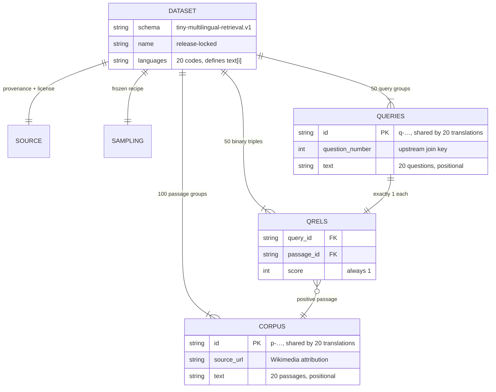

# tiny-embedding-bench

A **frozen, byte-verified multilingual retrieval benchmark** — a tiny Belebele subset with binary question→passage labels — plus the tooling to build and validate it:

- **`bench-distill-builder/`** — Python builder; downloads a pinned Hugging Face snapshot, samples deterministically, writes the dataset + manifest
- **`src/`** — TypeScript schema (`types.ts`) and Bun validator (`validate.ts`) that re-checks the schema and proves `dataset.json` matches `MANIFEST.json`
- **`datasets/tiny-embedding-bench-v1/`** — the built artifact (dataset, manifest, review page)

## Quick Start

One-liner from the repo root: 

```bash
make setup
make create-dataset
make validate
```

## At a glance

All numbers below are **measured from `dataset.json` itself** by `make stats` — not inferred, not hand-counted.

| Metric | Value |
|---|---:|
| Languages | 20 |
| Passage groups (haystack size per language) | 100 |
| Localized passages (total) | 2,000 |
| Query groups (needles per language) | 50 |
| Localized queries (total) | 1,000 |
| Qrels | 50 |
| Positives per monolingual query | 1 of 100 |
| Positives per mixed-language query | 20 of 2,000 |
| `dataset.json` size | 954,985 bytes (hard cap: 1,000,000) |

## Language support

Per-language UTF-8 footprint, measured across all 100 passages and 50 queries:

| # | Language | Code | Corpus bytes | Query bytes | Avg bytes / passage |
|---:|---|---|---:|---:|---:|
| 1 | English | `eng_Latn` | 28,695 | 3,112 | 287 |
| 2 | German | `deu_Latn` | 33,813 | 3,194 | 338 |
| 3 | French | `fra_Latn` | 34,999 | 3,959 | 350 |
| 4 | Spanish | `spa_Latn` | 34,206 | 3,469 | 342 |
| 5 | Portuguese | `por_Latn` | 31,762 | 3,188 | 318 |
| 6 | Italian | `ita_Latn` | 33,922 | 3,411 | 339 |
| 7 | Dutch | `nld_Latn` | 31,632 | 3,100 | 316 |
| 8 | Polish | `pol_Latn` | 32,157 | 3,123 | 322 |
| 9 | Russian | `rus_Cyrl` | 56,056 | 6,227 | 561 |
| 10 | Turkish | `tur_Latn` | 31,717 | 3,023 | 317 |
| 11 | Modern Standard Arabic | `arb_Arab` | 45,171 | 4,446 | 452 |
| 12 | Hindi | `hin_Deva` | 73,197 | 7,522 | 732 |
| 13 | Bengali | `ben_Beng` | 75,708 | 7,690 | 757 |
| 14 | Urdu | `urd_Arab` | 50,347 | 4,945 | 503 |
| 15 | Indonesian | `ind_Latn` | 30,951 | 3,228 | 310 |
| 16 | Vietnamese | `vie_Latn` | 39,344 | 3,900 | 393 |
| 17 | Thai | `tha_Thai` | 78,315 | 7,235 | 783 |
| 18 | Simplified Chinese | `zho_Hans` | 26,466 | 2,700 | 265 |
| 19 | Japanese | `jpn_Jpan` | 36,336 | 4,296 | 363 |
| 20 | Korean | `kor_Hang` | 35,163 | 3,693 | 352 |

## Schema

`text[]` arrays are **positional**: `text[i]` is written in `languages[i]`, and all 20 translations of a passage/question share one id. That is why 2,050 records fit under 1 MB and qrels are stored once instead of per language.



## Commands

| Command | What it does |
|---|---|
| `make setup create-dataset` | Create venv + deps, then (re)build `datasets/tiny-embedding-bench-v1/` |
| `make validate` | Schema-check `dataset.json`, cross-check `MANIFEST.json` (counts, hashes, byte cap) |
| `make stats` | Print the measured statistics quoted above |
| `bun run typecheck` | Typecheck `src/` (Bun runs TS directly; `tsc` is check-only) |
| `make -C bench-distill-builder test` | Run the builder's Python test suite |

## Caveats

- Gold labels are **source-passage associations**, not exhaustive relevance judgments; queries were assistant-screened on English only. See `bench-distill-builder/README.md` for evaluation interpretation.
- Source data: [facebook/belebele](https://huggingface.co/datasets/facebook/belebele) (pinned commit), **CC-BY-SA-4.0** — attribution in `NOTICE.md` and each record's `source_url`.
